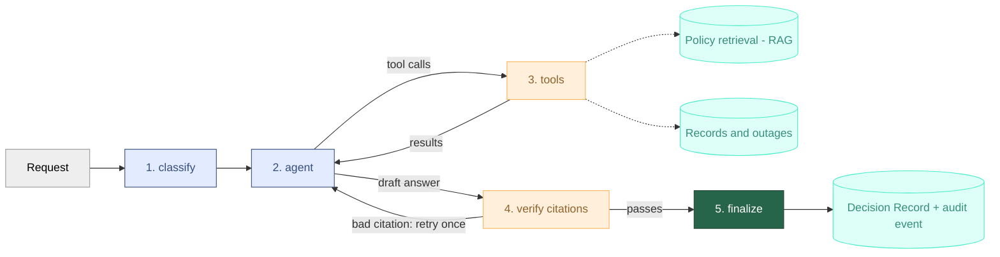

# Internal HR/IT Support Agent

[](https://github.com/mgetech/internal-support-agent/actions/workflows/ci.yml)

An internal employee support agent for HR and IT — the AskHR / internal-helpdesk class
of enterprise agent, built from scratch. It is designed to resolve requests like "how
many vacation days do I have left?", "can you book me off next week?" and "is the VPN
down, or do I need a ticket?" by querying the requesting employee's own records and
searching company policy with **hybrid retrieval** — then terminating in exactly one
of four outcomes: **resolve**, **propose an action** into a human approval queue,
**escalate** to a human, or **refuse with a citation**. Every request also produces a
**Decision Record**: a persisted, structured account of why the agent did what it did.
All data is synthetic.

## How a request flows



The dotted lines show where the data comes from. An answer may cite only the chunks that
the retrieval returned for this request. A request that is out of scope, meets a model
failure, reaches the tool limit or fails the citation check twice ends in `escalate`
instead of an answer. Every path ends in `finalize`.

## Status

**Work in progress.** The agent and its REST API are built. The UI has a chat tab with numbered policy sources under each answer and, for HR
partners, a "Why this answer?" view, a "My requests" tab, an approval queue tab, a decision records tab and thumbs feedback. The agent runs against a live model in the compose
stack, but the automated tests use a scripted one. What exists today:

- **Synthetic data.** Employees, leave balances and outages come from one generator. The
  output is identical for the same as-of date, which is today unless given, so the stack
  runs in any year. The policies in `data/policies` are written by hand, are fictional and
  are not legal advice. CI fails if a policy text changes without a new `policy_version`,
  or if a chunk id or chunk text changes without an updated snapshot.
- **Identity from the session.** Tools read the employee from the request. The model
  never gives an employee id, and no tool accepts one.
- **Typed tools.** Six tools. Read tools query the employee's own records. The model
  never writes SQL.
- **Proposals, not writes.** Write tools add to an approval queue and change nothing.
- **Role-checked approval.** Only an `hr_partner` or a `manager` can decide, never on their
  own request. A decision locks the action, so it cannot be decided twice. An approval
  makes the write and a rejection writes nothing.
- **REST API.** `POST /chat`, the approval queue, Decision Records and feedback. Login is
  a header stub for now. See [REST API](#rest-api).
- **Hybrid retrieval.** Vector search and full-text search, joined by reciprocal rank
  fusion.
- **Agent graph.** classify → agent ⇄ tools → verify → finalize, on LangGraph. A small
  model classifies first, so a request that is out of scope ends before the agent and its
  tools run.
- **Citation check.** Every cited chunk must come from this request's search.
- **Refusal with citation.** The agent ends a request that goes against a policy or the
  employee's permissions with `decline_request`. The refusal must cite a section from this
  request's search, or it is retried once and then escalated.
- **Decision Records.** One saved record per request: outcome, reason, evidence, versions
  and cost.
- **Model client.** Responses API, retry, fallback model and a cost in euros per call.
- **Audit log.** Every tool call, proposal, approval, execution, feedback and model call,
  with the request id and the actor.
- **Tracing.** With Langfuse keys set, each chat request is one trace with a span for every
  graph node and tool call and a generation for every model call, with tokens, cost and
  latency. The Decision Record has the trace id. Without keys, tracing is off. A tracing
  failure never affects a request. Inputs and outputs are in the trace only when
  `TRACE_CONTENT=true`, which is for synthetic data. Application logs never hold message text or
  employee ids. Costs in euros are authoritative in the Decision Records. A generation has
  no cost, only the model name and the token counts, so Langfuse shows its own estimate in
  dollars. To
  make that estimate match, define the Azure deployments as custom models in Langfuse.
- **Versioned prompts.** A prompt change without a version bump fails a test.
- **Docker Compose.** One command starts the database, the API and the UI. The seed data
  is loaded once, on the first start.
- **Tests.** Unit, component and database integration tests, with no model keys needed.
  The security tests run for every tool. CI runs them against Postgres and also fails when
  a policy text changes without a new `policy_version`, or when a chunk id or chunk text
  changes without an updated snapshot.

The details and the reasons are in [docs/architecture.md](docs/architecture.md). The Stack
table below shows which parts are built and which are planned.

## Failure modes

What the system does when something goes wrong, and what proves it. A row is here only when
the behavior and its test exist.

| Failure | What the system does | Proven by |
|---|---|---|
| Model API error | The client retries the same model up to two more times. If that fails, it tries the fallback model, when one is set. If every model fails, the request ends in `escalate`. The tries are listed in the Decision Record. | `src/support_agent/llm.py`, `tests/test_llm_fallback.py`, `tests/test_agent_node.py` |
| An error escapes a graph node | The request ends in `escalate`. The Decision Record has the error and the node, and the employee gets a short reply with the request id. A proposal made before the error keeps its record. If saving the record fails too, the answer is a plain 500. | `src/support_agent/nodes.py`, `tests/test_node_failure.py` |
| The agent reaches the tool limit | The calls that would go over the limit (8 by default) are not run. The request ends in `escalate`. | `tests/test_tools_node.py`, `tests/test_decision_record.py` |
| An answer cites a section the search did not return, or a refusal has no citation | The agent runs once more and sees the objection. If it fails again, the request ends in `escalate`. | `src/support_agent/guardrails/verifier.py`, `tests/test_verifier.py`, `tests/test_decline_request.py` |
| The same write is requested twice | The action that is still waiting is returned. No second action is added. | `tests/test_tools_db.py` |
| The process crashes after a proposal | The action stays pending and has no Decision Record. The orphan check flags it in the audit log. Nothing runs that check automatically yet. | `src/support_agent/reconciliation.py`, `tests/test_reconciliation.py` |
| Wrong role, or approval of your own request | The decision is refused (HTTP 403) before the action is locked. Nothing changes. | `tests/test_approval.py`, `tests/test_api.py` |
| A request for a colleague's data | No tool takes an employee id, so there is no way to ask for it. The agent refuses and cites the privacy policy. | `tests/test_tool_contracts.py`, `tests/test_api.py`, scenario S005 in [docs/evaluation.md](docs/evaluation.md) |

The gaps that are known today are listed in
[docs/architecture.md](docs/architecture.md#known-limits).

## Roadmap

Rough build order:

- **Walking skeleton** — deterministic synthetic HR/IT data and a heading-aware chunker;
  session-bound identity and a full audit trail; the typed tool belt, with its
  access-control tests written before the tools they constrain; the agent graph,
  citation verifier and Decision Records; role-checked human approval behind a REST
  API; a Streamlit review surface.
- **Evaluation gate** — scenarios with authored expected outcomes, run n=3 and wired
  into CI, so a change that makes the agent behave worse fails the build. Prompts are
  versioned config: a wording change without a version bump is a test failure.
- **Depth** — the same tool belt over MCP, with identity bound at session
  initialization rather than passed as an argument; adversarial scenarios (prompt
  injection, colleague-data probing, approval bypass); retrieval evaluation and the
  chunking ablation, with a re-ranking comparison, and tables published.
- **Governance** — DSAR export, retention purge, and a database-level assertion that no
  record was ever written without passing through human approval.
- **Observability and feedback** — per-node traces with cost and latency budgets, a
  usage dashboard, and a path that turns a thumbs-down into a new eval scenario.

Future work:

- **Azure deployment of the full stack** — app, database and a self-hosted Langfuse in one
  EU subscription — for teams that want full trace content with real employee data.

## Stack

| Layer | Choice | Status |
|---|---|---|
| Language | Python 3.12 | In place |
| DB | PostgreSQL 16 + **pgvector** | In place |
| Tests | pytest, incl. DB-backed tests against the compose/CI Postgres | In place |
| CI | GitHub Actions — ruff + pytest always; eval gate when model secrets are configured | Partial — lint, and tests against Postgres with the policy checks; the eval gate is planned |
| Packaging | Docker + docker-compose (db, api, ui) | In place — a one-time seed step runs before the API |
| Orchestration | **LangGraph** | Partial — graph built, served by `POST /chat` and tested with a scripted model |
| Model inference | **Azure OpenAI via AI Foundry** — a capable deployment for the agent loop, a small one for classification and claim extraction, `text-embedding-3-small` (1536-dim) | Partial — embeddings, and a model client with retry, fallback and cost; the graph uses the client; tests use scripted replies, and the six eval scenarios have also run against a live model |
| API | FastAPI | Partial — see [REST API](#rest-api); login is a header stub |
| Retrieval | Metadata pre-filtering → hybrid pgvector cosine + Postgres full-text ranking (`ts_rank_cd`), reciprocal-rank fusion (k=60), top-5 | Partial — hybrid search in place; metadata pre-filtering planned |
| Chunking | Pluggable `Chunker` interface; structural (heading-aware) default, chosen by ablation against fixed-size, recursive and semantic | Partial — structural chunker only |
| MCP | Official Python MCP SDK (FastMCP) exposing the tool belt; stdio + streamable HTTP | Planned |
| Eval tooling | Own deterministic harness (gates, trajectory, retrieval) + **RAGAS** for answer quality | Partial — six scenarios and a deterministic runner (`make eval`, one run each); gate, n=3 and RAGAS planned. See [docs/evaluation.md](docs/evaluation.md) |
| Observability | **Langfuse** (cloud keys via `.env`; self-hostable for residency) | Partial — a trace for each chat request, with a span for every graph node and tool call and a generation for every model call; off without keys. Prompt tags and scores are planned |
| UI | Streamlit — chat, approval queue, decision records, cost | Partial — chat, my requests, approval queue and decision records tabs (`make ui`); the cost tab is planned |

## REST API

| Route | What it does | Status |
|---|---|---|
| `POST /chat` | runs the agent for one message and returns the answer, the outcome and the request id | Built |
| `GET /approvals` | the actions waiting for approval, with their payload. Approvers only | Built |
| `POST /approvals/{id}` | approves or rejects an action. Approvers only, never their own request | Built |
| `GET /decisions` | Decision Records as a list, newest first, filtered by outcome and date. HR partners only; they can list another employee's too | Built |
| `GET /decisions/{request_id}` | the Decision Record of a request: why the agent did what it did. HR partners only | Built |
| `GET /policy-chunks/{chunk_id}` | the text of one policy section, as an answer cites it | Built |
| `POST /feedback/{request_id}` | a rating and an optional comment on an answer | Built |
| `GET /me/actions` | your own actions in any status, with who decided and when | Built |
| `GET /me/export` | everything the system holds about the employee | Planned |
| `GET /usage` | requests, tokens and cost in euros per day and employee | Planned |

The employee comes from the `X-Employee-Id` header, which is a login stub for now. No
model-visible tool accepts an employee identifier; the caller's identity comes only from the
authenticated request.


## Quickstart

You need Docker and an Azure AI Foundry resource. Deploy the models that `.env.example`
names in that resource: an LLM for the agent (`gpt-5.1`), a smaller LLM for classification
(`gpt-5.1-mini`) and an embedding model (`text-embedding-3-small`). To use other models,
change the deployment names in `.env`.

```
cp .env.example .env     # then fill in the Azure values
docker compose up
```

Open the UI at http://localhost:8501. The API is at http://localhost:8000.

On the first start, Compose creates the database with the schema, loads the seed data once
and then starts the API and the UI. The seed step sends the policy text to the embedding
deployment, so the Azure values must be right. Later starts skip the seed and keep your
data. If a port is already in use, set `DB_PORT`, `API_PORT` or `UI_PORT` in `.env`.

`db/init.sql` runs only on a new database. After a change to the schema, run
`make reset-db`. It deletes the database volume, starts a new database and seeds it. Run
`make setup` once before it.

To work on the code, run `make setup`, `make db-up` and `make seed`. Then `make test` and
`make lint` work. The tests need no model keys. They drop and rebuild the schema of their
database, so `make test` runs them on a separate database, `support_agent_test`, which it
creates on the same server. The suite refuses to run on any database whose name does not
end with `_test` or `_scratch`.


## License

This project is licensed under the Apache License 2.0. See [LICENSE](LICENSE).
